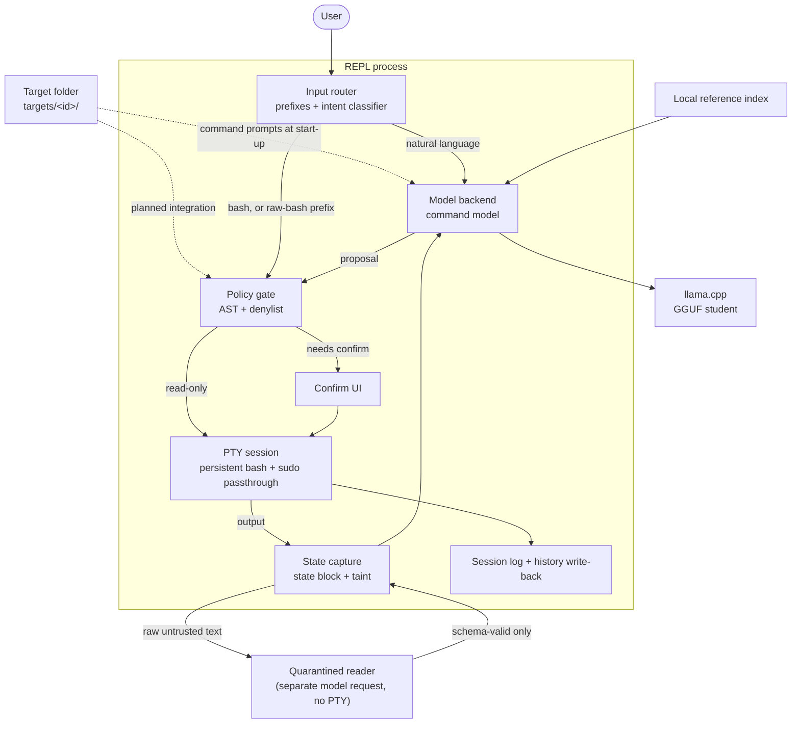

# 5. Building block view

> Living document. The component view describes the intended system; target-consumer
> implementation status is distinguished below. Components not yet built are marked
> *(planned)* in 5.3.

## 5.1 Components

| Component | Responsibility | Safety-critical |
|---|---|---|
| Input router | Prefix modes (`\`, `?`, `@`, `@@`, `:`); otherwise the intent classifier picks bash or natural language | No (a wrong route still hits the gate) |
| State capture | Builds the state block; truncates output; filters env; labels taint | Yes (taint, secrets) |
| Model backend | Builds the prompt from the editable YAML prompts; calls the command model; parses the proposal | No (its output is untrusted) |
| Policy gate | Classes every command by the allowlist, static rules and the live session snapshot (spec `policy-gate/v1`) | **Yes, the most critical** |
| Confirm UI | Shows the command exactly as bash will parse it; strips escape sequences | Yes |
| PTY session | One persistent bash with a control channel on fd 3 for start/done records and session snapshots (spec `pty-protocol/v1`); input forwarding; sudo passthrough | Yes (password, completion) |
| Quarantined reader | Reads raw untrusted text as a separate model request; returns only fixed choices and validated names (ADR-0017) | Yes |
| Session log, history | JSONL per turn; appends executed commands to `~/.bash_history`; silent during passthrough | Yes (secrets) |
| Target folder `targets/<id>/` | Active-target data shared by REPL start-up, gate, installer and pipeline; status below | Yes (policy and model integrity) |
| Installer | GPU detection, weight download and verification, install-time doc harvest | Yes (integrity) |

### Target folder and consumers

[ADR-0023](../adr/0023-os-targets.md) defines `targets/<id>/`; the shared gate
procedure consumes target-owned OS inputs ([policy-gate/v1](../specs/policy-gate/v1.md)).
`ubuntu-26.04` is the first and currently only target; bash remains the only shell.
The folder currently contains `target.toml`, `sensitive.toml`, `gate-vectors.toml`
and `prompts/`. Targets are not packaged yet (#48, #50).

- **REPL start-up (built):** Loads `target.toml` and command `prompts/`; selects by
  exact os-release `ID` and `VERSION_ID`, never `ID_LIKE` or a nearby version. With
  no match the user must name a target via `--target` or `config.toml`. A mismatched
  named target currently produces a warning.
- **REPL target inputs (planned):** Read `model.toml`, check SHA-256 and refuse
  mismatched weights; read `sensitive.toml` for sensitive-data handling. These inputs
  are not built.
- **Gate integration (planned, #12, #190):** Use the target's package-owner query,
  `sensitive.toml` and planned `allowlist.toml`. On a mismatched named target,
  every command must need confirmation. These integrations are not built;
  gate-vector loading from `gate-vectors.toml` is built for conformance tests.
- **Reader module (built, not yet wired into the REPL):** Loads
  `prompts/reader.yaml` and resolves the target's `command_provider` for local lookups.
- **Installer (planned, #48, #50):** Reads `model.toml` to download and verify weights;
  ships every target's runtime files. Model integrity and adapter compatibility
  remain requirements awaiting implementation (section 7).
- **Pipeline (planned):** Reads `harvest.toml` for harvest inputs and the reference
  VM, `prompts/` for training and `eval/` for training/release evaluation.
  `harvest.toml` and `eval/` are build-time material, not runtime files; neither
  exists yet, nor do `model.toml` or `allowlist.toml`.

## 5.2 Build-time components (not shipped)

| Component | Responsibility |
|---|---|
| Reference VM and harvest | Per-target VM with snapshots (initially `ubuntu-26.04`); harvests man pages, `--help`, packages, units, `/etc` defaults |
| Data pipeline | Back-translation, grounded generation, correction pairs, synthetic sessions, execution filter |
| Training | QLoRA fine-tuning of the student; intent-classifier training |
| Eval suite | The metrics in section 10, against any backend |

## 5.3 Code layout

Python package `nl_shell` under `src/`, tests under `tests/`, run with `python3 -m pytest`.

| Module | Component | Status |
|---|---|---|
| `nl_shell.cli` | Entry point (`nl-shell`, `python -m nl_shell`) | built (M0.1) |
| `nl_shell.repl` | The read loop; exit commands | built (M0.1) |
| `nl_shell.router` | Input router: heuristic command vs. natural language (first token is on `$PATH` or a bash builtin, and the line does not read as an English sentence: an unbalanced `'` outside a `#` comment, or 4+ plain words with a function word like "the" or "in" and no single-quoted word); the M3 classifier keeps it as its fallback | built (M0.7) |
| `nl_shell.targets`, `nl_shell.os_release` | Target loading and exact os-release selection | built; target packaging planned (#48, #50) |
| `nl_shell.gate.vectors` | Target gate-vector loading | built; gate integration above remains planned |
| `nl_shell.prompts` | Command prompt loading from the selected target | built, loaded at start-up |
| `nl_shell.reader`, `nl_shell.command_provider` | Reader prompt and target package-query lookup | built modules; reader not yet wired into REPL |
| PTY session, state capture, policy gate integration, confirm UI, session log | — | *(planned)* |
